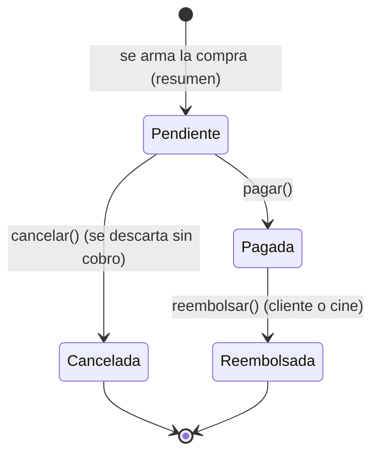
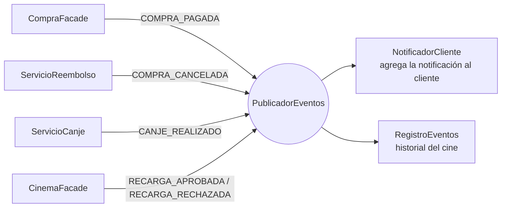

# CinemaUQ – Patrones de diseño

Este documento resume los patrones aplicados en el modelo y dónde encontrar cada uno.
Todas las rutas son relativas a
`proyectoFinalCinemaUQ/src/main/java/co/edu/uniquindio/poo/proyectofinalcinemauq/`.

| Patrón | Tipo | Clases principales | Para qué se usa |
|---|---|---|---|
| Singleton | Creacional | `model/facade/CinemaFacade` | Todas las pantallas comparten el mismo estado del cine. |
| Builder | Creacional | `model/venta/Compra.CompraBuilder` | Armar una compra paso a paso (entradas, productos, promociones, fecha) y validarla al final. |
| Factory Method | Creacional | `model/tarjeta/MovimientoCreator` y sus creadores; `model/reporte/ReporteFactory`, `ReporteTxtFactory`, `ReportePdfFactory` | Cada creador decide qué movimiento o qué tipo de reporte se instancia. |
| Facade | Estructural | `model/facade/CinemaFacade`, `model/facade/CompraFacade` | Punto de entrada único para los controladores de JavaFX; el proceso de compra queda en una sola fachada. |
| Proxy | Estructural | `model/tarjeta/MedioPago`, `TarjetaProxy`, `TarjetaVirtual` | Proxy de protección: valida estado y saldo de la tarjeta antes de cada débito y registra los intentos rechazados. |
| Composite | Estructural | `model/venta/ItemConfiteria`, `Producto`, `Combo` | Un combo puede contener productos u otros combos y se trata igual que un producto. |
| Decorator | Estructural | `model/promocion/Cotizacion`, `PromocionDecorator`, `DescuentoPorcentaje`, `DescuentoMontoFijo` | Cada promoción aplicable envuelve la cotización anterior y suma su descuento. |
| Strategy | Comportamiento | `model/reembolso_Strategy/PoliticaReembolso` y sus políticas; `ReglaAcumulacionPuntos`; `ReglaCostoRedencion` | El porcentaje de reembolso, los puntos ganados y el costo de un premio se cambian sin tocar los servicios. |
| Observer | Comportamiento | `model/eventos/PublicadorEventos`, `ObservadorCine`, `NotificadorCliente`, `RegistroEventos` | Los servicios publican eventos (compra, cancelación, canje, recarga) sin saber quién los escucha. |
| State | Comportamiento | `model/venta/estado/*`, contexto `model/venta/Compra` | El ciclo de vida de la compra decide qué operaciones son válidas en cada momento. |

---

## State – ciclo de vida de la compra

La compra guarda su estado como un objeto (`EstadoDeCompra`) y le delega cada transición.
Cada estado devuelve el siguiente estado o lanza `CompraInvalidaException` si la operación no
está permitida. Así `Compra` no tiene condicionales sobre su estado.

| Estado | `pagar()` | `reembolsar()` | `cancelar()` | `admiteReembolso()` | `fueCobrada()` |
|---|---|---|---|---|---|
| `EstadoPendiente` | → Pagada | error | → Cancelada | no | no |
| `EstadoPagada` | error | → Reembolsada | error | sí | sí |
| `EstadoReembolsada` | error | error ("ya fue reembolsada") | error | no | sí |
| `EstadoCancelada` | error | error | error ("ya estaba cancelada") | no | no |

El enum `EstadoCompra` se mantiene como el **nombre visible** del estado (lo usan las tablas y
los reportes); el comportamiento vive en las clases de `model/venta/estado`.

## Strategy – políticas de reembolso

`ServicioReembolso` recorre las políticas en orden y usa la primera que aplique:

| Política | Cuándo aplica | Devuelve | ¿Exige conservar los puntos ganados? |
|---|---|---|---|
| `PoliticaFuncionCancelada` | El cine canceló la función | 100 % | No: se quitan solo los puntos que le queden al cliente |
| `PoliticaReembolsoCompleto` | Faltan 24 h o más | 100 % | Sí |
| `PoliticaReembolsoParcial` | Faltan entre 2 h y 24 h | 80 % | Sí |
| `PoliticaSinReembolso` | Siempre (último recurso) | 0 % (no se puede cancelar) | — |

Cuando el administrador cancela una función (`CinemaFacade.cancelarFuncion`):

1. Se valida que la función esté programada y que todas las tarjetas afectadas estén activas
   (si alguna no lo está, no se cambia nada).
2. La función pasa a `CANCELADA`.
3. Cada compra pagada se reembolsa con `ServicioReembolso.reembolsarPorFuncionCancelada`:
   devuelve el dinero, libera asientos, repone stock, restaura bonos y revierte puntos.
4. Cada cliente recibe una notificación por el Observer.

## Observer – eventos del cine

`CinemaFacade` crea un único `PublicadorEventos`, suscribe los dos observadores y se lo pasa a
los servicios por constructor.

## Factory Method – reportes exportables

`FormatoReporte` (TXT o PDF) entrega la fábrica de su formato. `ServicioReportes` solo conoce la
interfaz `ReporteFactory` y el producto abstracto `Reporte`; agregar un formato nuevo (por
ejemplo CSV) solo requiere una subclase de `Reporte`, su fábrica y una constante en el enum.
